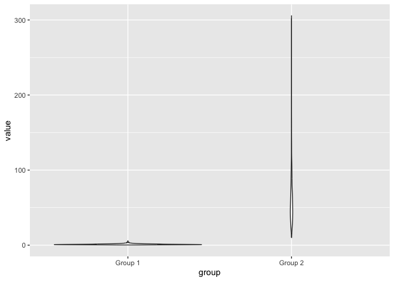
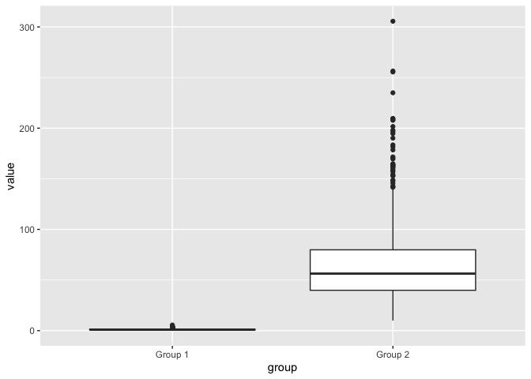

violin plot demo
================
Hao Ye
25 November, 2026

## Generate sample data

``` r
df <- data.frame(group = rep(c("Group 1", "Group 2"), each = 1000), 
                 value = c(exp(rnorm(1000, mean = 0, sd = 0.5)), 
                          exp(rnorm(1000, mean = 4, sd = 0.5))))
```

## Make violin plot

``` r
my_plot <- ggplot(data = df, mapping = aes(x = group, y = value))

print(my_plot + geom_violin())
```

<!-- -->

## Make boxplot

``` r
print(my_plot + geom_boxplot())
```

<!-- -->
